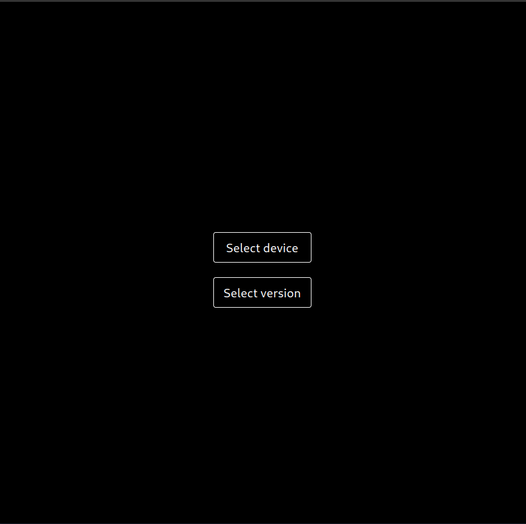
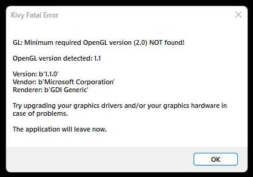
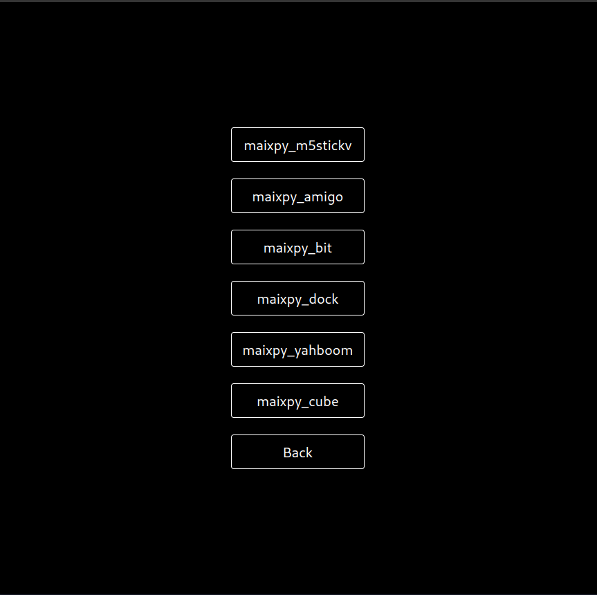
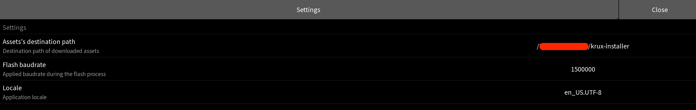
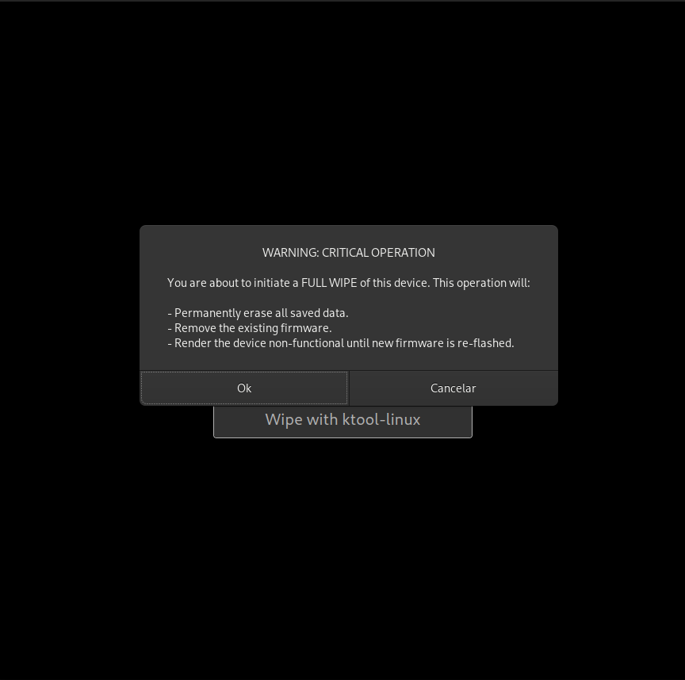

# Usage

Krux Installer bundles one version of the Krux firmware. Once installed, it can
flash your device offline. To use a different firmware version, download an
[installer release](https://github.com/selfcustody/krux-installer/releases) that
bundles it or follow the [manual installation instructions](../from-pre-built-release.md).

## Main menu

Open Krux Installer, read the disclaimer, and click **I understand** to continue.
On Linux, the installer may ask for permission to access the USB serial port.
Follow the on-screen instructions if prompted.

**Flash firmware** and **Wipe device** become available after you select a device.
You can open **Settings** and **About** from the main menu at any time.

### Kivy Fatal Error - OpenGL

Krux Installer uses Kivy and requires OpenGL 2.0 or later. On Windows, if the
installer shows an OpenGL error, try installing the
[OpenCL™, OpenGL®, and Vulkan® Compatibility Pack](https://apps.microsoft.com/detail/9nqpsl29bfff)
from Microsoft.

## Select device

Click **Device: select a new one**, then choose your device model. The installer
returns to the main menu with the selected model next to **Device**.

Models unavailable for the bundled firmware are dimmed.

## Flash device

1. Connect your device to the computer with a USB data cable and turn it on.
2. Confirm that the model shown next to **Device** matches your hardware, then
   click **Flash firmware**.
3. Leave the device connected until the installer displays **DONE**.

The installer checks the bundled firmware against its build-time SHA256 hash
before flashing.

----8<----
flash-krux-logo.en.txt
----8<----

### Error flashing

If flashing fails or stalls while trying to enter K210 ROM ISP mode, see
[Error when flashing](../../../troubleshooting.md#error-when-flashing).

### Air-gapped update

After the initial USB installation, you can install subsequent updates using
the [microSD card update guide](../../features/sd-card-update.md).

## Settings

Open **Settings** to change **Flash baudrate**, which controls how fast firmware
is written over USB, or **Locale**, which changes the installer language.

## Wipe device

Wiping permanently erases saved data and removes the firmware. Back up any
wallet recovery information you need before proceeding.

1. Connect the device over USB and select its model.
2. Click **Wipe device** and read the warning. Click **Proceed** to start the wipe.
3. Leave the device connected until the installer displays **DONE**. Disconnect
   and reconnect it before flashing the firmware again.

----8<----
tips-after-install.en.txt
----8<----
